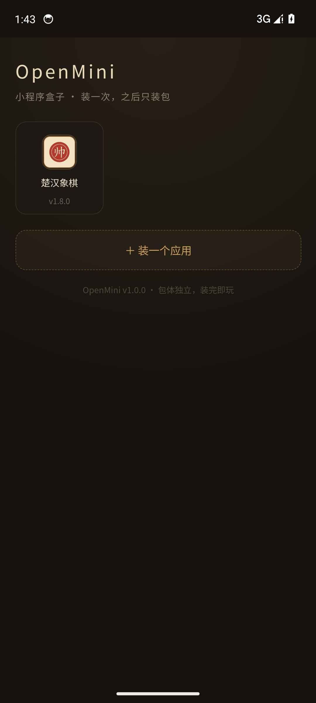
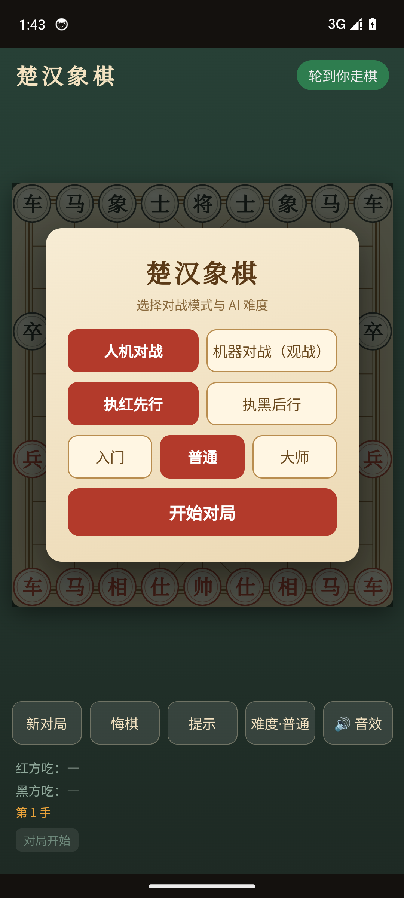

# OpenMini · 小盒子

**一个 104 KB 的小程序宿主 APK。装一次，以后所有小应用、小游戏都打成 zip 包随时装进去。**

An Android mini-app host in 104 KB — install the shell once, then drop in H5 apps as zip packages.
No repackaging the APK, no app store review.

<p align="center">
  
  
</p>

---

## 它解决什么问题

用 WebView 壳打包小应用（见 [android-apk-builder](https://github.com/joeyjiaojg/chess) 那条路线）时，改一行游戏逻辑就得重新打包、重新安装、重新发给朋友。

OpenMini 把**运行时**和**内容**拆开：

- APK 里只有启动器 + WebView 运行时（约 60 KB）和几个 Java 类，零第三方依赖
- 每个应用是一个 zip 包（`manifest.json` + 网页资源），装进盒子后独立运行
- 每个应用跑在独立虚拟域名 `https://<id>.apps.local` 上，**origin 不同 = localStorage 存档天然隔离**
- 升级只替换包目录，存档存在 WebView 数据区 → **升级不丢档**

改游戏只需重新打一个几十 KB 的 zip 发给朋友，全程十几秒。

## 工作原理

```
┌─────────────────────────── APK（装一次）───────────────────────────┐
│  MainActivity                                                      │
│    WebView ── https://host.apps.local/  → assets/host/   (启动器)   │
│           └─ https://<id>.apps.local/*  → files/apps/<id>/ (应用包) │
│    shouldInterceptRequest 按 host 前缀路由，不联网、不引 AndroidX     │
│  AppStore    包列表 / 安装 / 升级 / 卸载 / 内置包首启播种             │
│  MiniServer  局域网 HTTP 服务，PUT 原始二进制上传                    │
└────────────────────────────────────────────────────────────────────┘
                                     ▲
                  zip 包（manifest.json + index.html + 资源）
                  三种装法：粘贴链接 / 手机选文件 / 局域网拖拽
```

关键点只有一条：**用子域名做 origin 隔离**。没走 `WebViewAssetLoader`，是因为它只能映射单域名 —— 那样所有应用共享同一个 localStorage，存档会互相覆盖、互相串号。`shouldInterceptRequest` 里按 `host` 后缀分流，40 行代码就够了。

顺带白赚两件事：页面是 `https://` 安全上下文，WebAudio / clipboard 等 API 直接可用；不用再像 `file://` 时代那样把 JS 内联进 HTML（那样报错永远只有一句 `Script error. @:0`），现在堆栈有真实行号。

## 下载 / 使用

从 [Releases](https://github.com/joeyjiaojg/openmini/releases) 下载 `OpenMini-v1.1.0.apk`，装到手机上（minSdk 21 / Android 5.0+）。首次打开**默认已装好「楚汉象棋」**（人机对战 / 机器对战观战 / 三档难度），拿来就能玩。

**桌面用户**：同一发布页下载 `OpenMini-Windows-v1.1.0-portable.zip`（Windows）或 `OpenMini-Linux-v1.0.0-x64.tar.gz`（Debian/Ubuntu，解压后跑 `install-desktop.sh` 即可双击启动）——免安装、不写注册表、**默认不预装任何应用**，在应用市场里点一下就装。桌面版数据统一放用户目录 `~/.openmini/`（Windows 为 `C:\Users\<你>\.openmini\`），旧版 `data/` 会自动迁移；需要 U 盘整体拷走时在 exe 旁建空文件 `portable.txt`。详见 [windows/README.md](windows/README.md)。

装新应用：

| 方式 | 怎么做 | 适用场景 |
|---|---|---|
| **粘贴链接** | 盒子右下「＋ 装一个应用」→ 链接页签 → 粘 zip 直链 | 把包丢 GitHub Release / 网盘，朋友粘链接就装 |
| **手机选文件** | 同上 → 文件页签 → 系统文件选择器选 zip | 微信/QQ 收到 zip；装过一次后直接点 zip 文件也能「用 OpenMini 打开」 |
| **局域网** | 同上 → 局域网页签 → 电脑浏览器打开面板里显示的完整地址（含 6 位 PIN），拖 zip 进去 | 开发调试最快；5 分钟无操作自动关闭，防蹭网 |

长按应用卡片可删除（存档一起清掉，因为存在该 origin 下）。

## 私有市场（授权应用）

v1.6.0 起，启动器多了一个「私有市场」Tab。公开市场只放不含第三方接口的应用；需要加载外部音源/接口的应用走私有市场：

- 仓库 `openmini-market-private`（私有）里只有密文：`meta.json`（盐/迭代次数）、`catalog.enc`、`apps/*.enc`
- 在小盒子里输入账号 + 口令 → 本机派生密钥（PBKDF2-HMAC-SHA256）→ 解密清单 → 安装时再解密包并校验 sha256
- 已装应用只能从 `https://<id>.apps.local/__om__/vault.json` 拿到**自己那份**配置；宿主未解锁时该请求返回 403，应用自动退回纯本地模式
- 应用包里不含任何接口地址与榜单数据，包本身不构成可用的「工具」

细节、威胁模型与维护流程见 [docs/PRIVATE-MARKET.md](docs/PRIVATE-MARKET.md)。

## 应用包格式

一个 zip，根目录直接放 `manifest.json` + 入口 + 资源：

```json
{
  "id": "demo",
  "name": "弹珠屏保",
  "version": "1.0.0",
  "versionCode": 1,
  "icon": "icon.png",
  "entry": "index.html"
}
```

| 字段 | 说明 |
|---|---|
| `id` | 必填。小写字母/数字/`-`/`_`，≤40 字符。决定虚拟域名与存档命名空间，**换 id = 换应用 = 新存档** |
| `name` | 显示名 |
| `version` / `versionCode` | 版本号，仅展示用；同 id 重装总是覆盖 |
| `icon` | 可省略，包内相对路径，PNG/JPG/WebP |
| `entry` | 默认 `index.html` |

细则见 [docs/PACKAGE-FORMAT.md](docs/PACKAGE-FORMAT.md)：zip 可以是「根目录平铺」或「只有一层子目录」（直接把文件夹压缩也认）；单包 40 MB 上限；解压做 zip-slip 校验。

打包：

```bash
python tools/make-pkg.py apps/demo                    # → dist/demo-v1.0.0.zip
python tools/make-pkg.py apps/demo --version 1.1.0 --version-code 2
python tools/make-pkg.py apps/xiangqi -o android/app/src/main/assets/apps/xiangqi.zip
```

放进 `android/app/src/main/assets/apps/*.zip` 的包会在**首次启动**时自动安装（只播一次，用户删掉后不会复活）。仓库里现在内置了 `xiangqi.zip`（源码在 `apps/xiangqi/`），所以新装的盒子打开就有象棋。

## 包里跑的是什么代码？能装别人的小程序吗？

**包里是普通网页**：`index.html` + CSS + JS，交给系统 WebView 直接渲染。没有 Node 运行时，不需要构建，也不要求单文件。

以 `apps/xiangqi/` 为例：

| 文件 | 是什么 |
|---|---|
| `index.html` / `css/style.css` | 页面骨架与样式 |
| `js/game.js` | 对局流程、Canvas 棋盘绘制（ES5：`var` + `function`，兼容老 WebView） |
| `js/bundle.js` | 规则引擎与 AI。源码本来是 CommonJS，开发时由 `tools/build-web.js` 用 20 行假模块系统（`__define` / `__require`）裹成 IIFE 挂到 `window.XQ` |

Node 只出现在**开发机上**（跑 `build-web.js` 把引擎源码打成浏览器可用的 bundle），产物是纯 JS，手机端不需要 Node。

**不能直接装微信小程序源码**：WXML / WXSS / `App()` / `Page()` / `wx.*` 都是微信运行时私有的，而 OpenMini 只提供浏览器环境。

| 手上的东西 | 能否直接打进盒子 |
|---|---|
| H5 / 普通网页 / Vite、React、Vue 的构建产物 | ✅ 可以 |
| 微信小程序源码（WXML / WXSS / `wx.*`） | ❌ 不行 |
| Taro / uni-app / kbone 项目，能编译出 H5 版 | ✅ 先出 H5，再打包 |
| 支付宝、百度等其它小程序源码 | ❌ 同样需要先转 H5 |

要让别人的小程序源码**原样**跑起来，得引入小程序运行时（FinClip 这类商用容器，或微信官方的 Donut / 小程序运行时），体积会从 104 KB 涨到几 MB，而且授权、兼容性都是坑 —— 这正是本项目刻意不做的事。

## 自己编译

需要 JDK 17 + Android SDK（platform 34 / build-tools 34）。

```bash
cp android/local.properties.example android/local.properties   # 填 sdk.dir 和你的 keystore
cd android && ./gradlew assembleRelease
# 产物: android/app/build/outputs/apk/release/app-release.apk
```

不填签名信息也能编译，只是产物未签名（`app-release-unsigned.apk`），装不上而已。

重新生成内置应用包（可选，改动了 `apps/` 才需要）：

```bash
python tools/make-pkg.py apps/xiangqi -o android/app/src/main/assets/apps/xiangqi.zip
```

## 目录结构

```
android/                          Gradle 工程（com.openmini.host）
  app/src/main/java/com/openmini/host/
    MainActivity.java             WebView + 虚拟域名拦截 + JS 桥 + 返回键栈
    AppStore.java                 包仓库：列表 / 安装 / 升级 / 卸载 / 内置播种
    MiniServer.java               局域网 HTTP 服务（ServerSocket，PUT 上传）
  app/src/main/assets/host/       启动器页面（index.html / style.css / host.js / lan.html）
  app/src/main/assets/apps/       内置应用包（*.zip，首启播种）
apps/
  demo/                           示例应用：弹珠屏保（单文件 canvas 动画，~3 KB）
  xiangqi/                        示例应用：楚汉象棋（引擎 + 棋盘 UI）
windows/                          Windows / Linux 桌面绿色版（Electron 宿主 + 打包脚本）
  src/paths.js                    数据目录解析与旧数据迁移（~/.openmini）
  build-portable.js               Windows zip 打包
  build-linux.py                  Linux tar.gz 打包（含 .desktop）
tools/make-pkg.py                 目录 → 应用包
docs/                             包格式说明、截图
```

## 技术要点 / 踩坑

- **子域名 origin 隔离**：`shouldInterceptRequest` 前先把路径 `..` 拒绝，再按 host 前缀取 `assets/host/` 或 `files/apps/<id>/`，返回 `WebResourceResponse`，二进制资源 charset 传 `null`。
- **包安装的原子性**：解压到 `cache/stage`（逐条 `canonicalPath` 防 zip-slip）→ 校验 manifest → 旧目录 rename 成 `.id.old` → stage rename 到位 → 删 old；rename 失败回退递归 copy。
- **JS 桥**：JS→Java 用 `@JavascriptInterface` 同步返回 String；Java→JS 只能 `evaluateJavascript`，所以安装这类耗时操作放后台线程，完成后 `runOnUiThread` 注入 `window.BoxUI.onResult(json)`。
- **返回键栈**：应用内按返回回启动器；启动器里面板/弹窗开着时先关面板（Java 侧用 `volatile overlayOpen` 跟踪，JS 在开关时调 `Box.setOverlay`）；再按才双击退出。
- **局域网服务**：`ServerSocket` 绑 0.0.0.0，8089 起向后试 8 个端口；协议故意用 `PUT + 原始二进制`，按 `Content-Length` 读 body，省掉 multipart 解析；浏览器端 `XMLHttpRequest` 自带上传进度。
- **不要叫 JS 全局变量 `history` / `location` / `top` / `name`**：严格模式下给 window 只读属性赋值直接抛 TypeError，脚本一启动就死，表现为「所有按钮都没反应」。
- 自动化测试时输入法弹出会改变 Web 页面布局坐标：`input tap` 前先 `keyevent 4` 收键盘，或改用 `uiautomator dump` 拿真实 bounds（WebView 内部元素也会出现在 dump 里）。

## 安全模型

装进来的包**拿不到任何宿主能力**：JS 桥走 `prompt()` 通道且只接受来自启动器
origin 的调用；WebView 只在 `*.apps.local` 内导航，外跳一律交给系统浏览器；
启动器渲染全程 `createElement`（包的 name/icon 当纯文本）；zip 有 zip-slip、
条目数、体积、路径白名单四重校验；局域网上传必须带 6 位 PIN 且 5 分钟空闲自动关闭；
`allowBackup=false` 挡 adb/云备份。

完整威胁模型、防线清单与红队实测记录见 [docs/SECURITY.md](docs/SECURITY.md)。

## 已知限制

- 只跑 H5 包，不跑小程序源码（详见上一节）。
- 只用系统 WebView，所以兼容性下限取决于手机 WebView 版本；老机器上请按 ES5 写代码。
- 应用之间不共享存档（这是设计目标），但也没有跨应用通信能力。
- 没有签名校验，装进来的包被视为可信 —— 只适合自用和小范围分发，别当应用商店用。

## 开源协议

[MIT](LICENSE)
